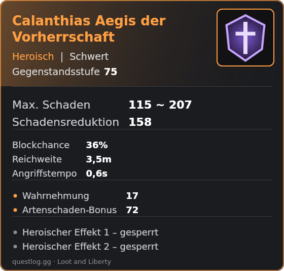
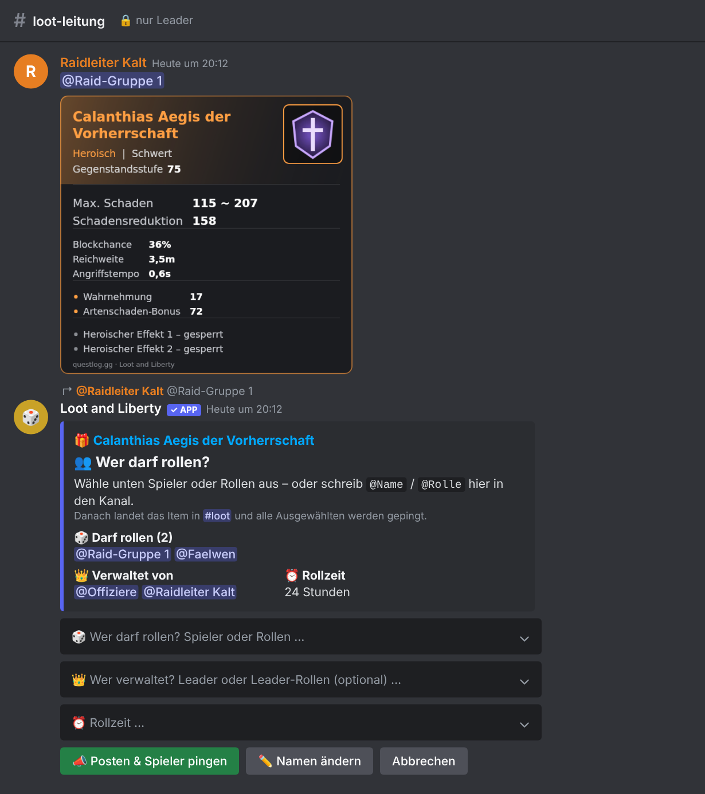
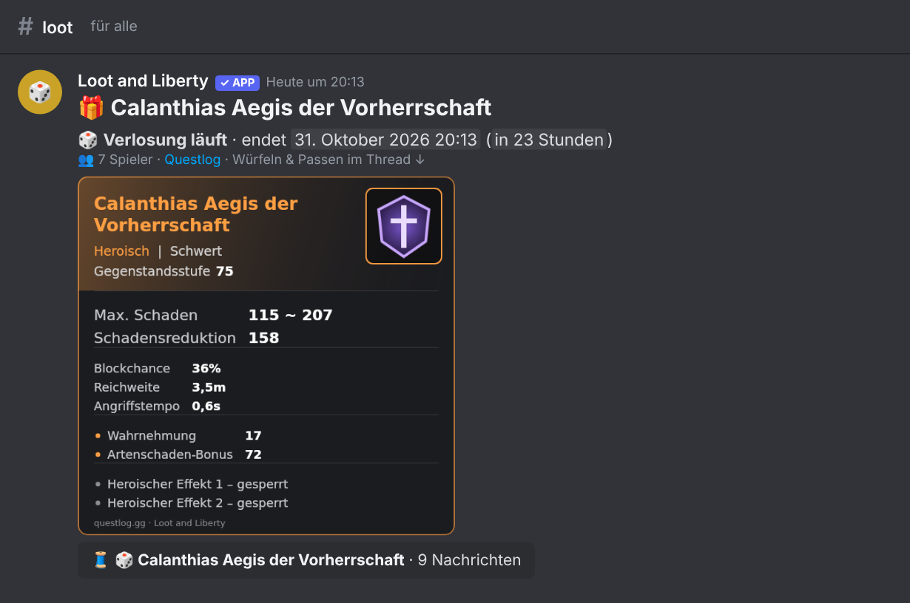
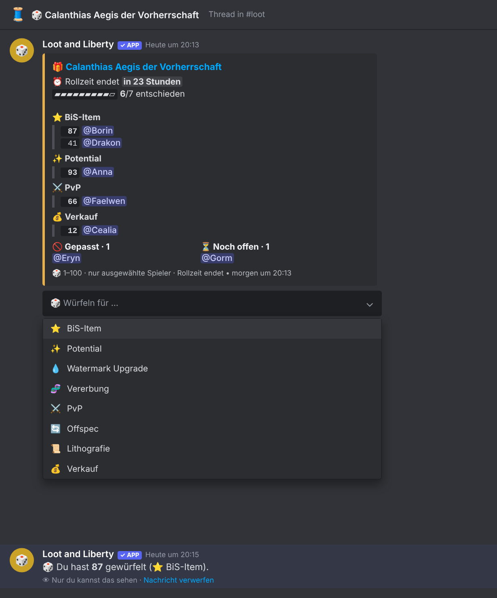
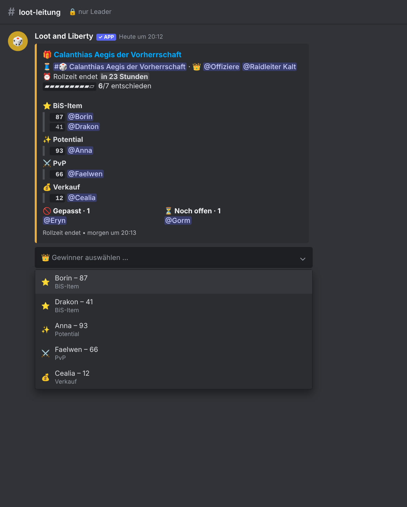
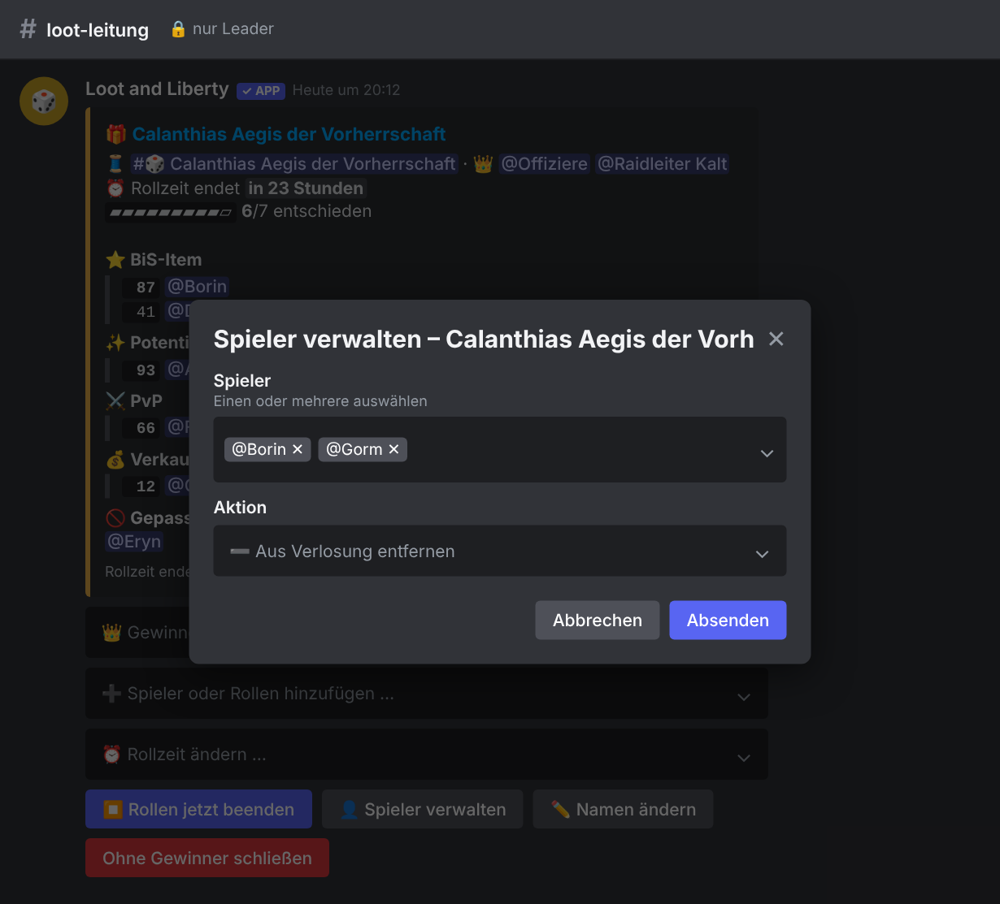
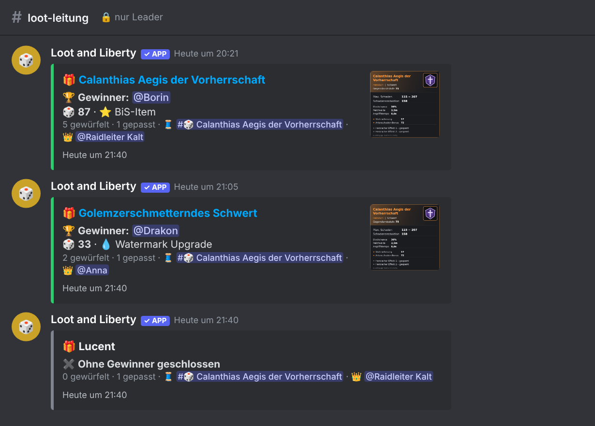
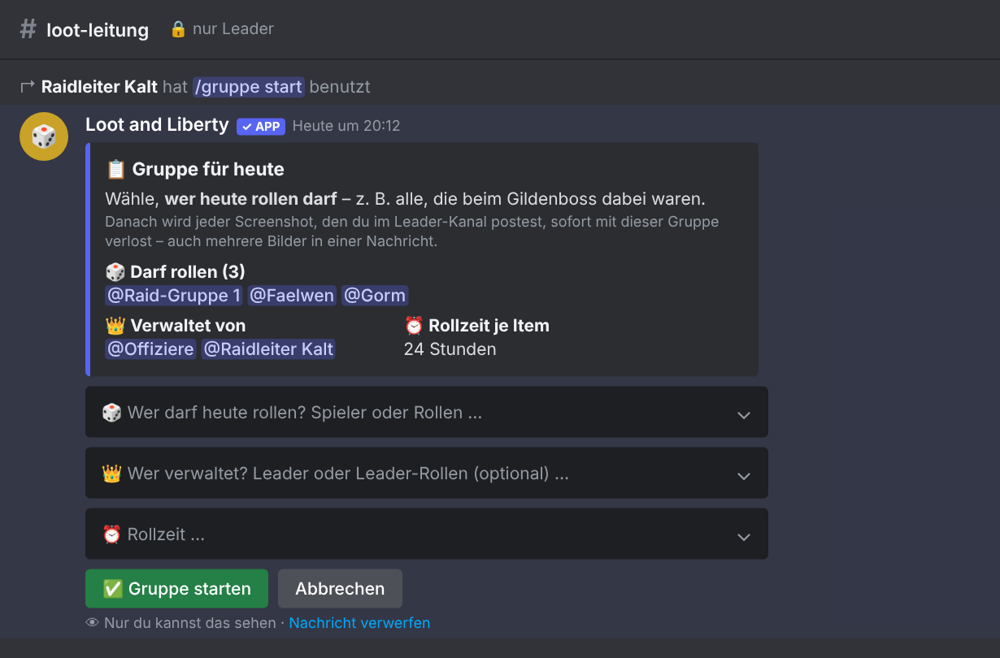

# Loot and Liberty

**Ein Discord-Bot für faire, nachvollziehbare Loot-Verteilung in _Throne and Liberty_.**

Leader posten einen Screenshot oder einen [Questlog](https://questlog.gg/throne-and-liberty)-Link und wählen aus, wer rollen darf. Den Rest übernimmt der Bot:
Item-Post mit Thread, Pings, Würfe 1–100 mit Grund (BiS, Potential, PvP …), Roll-Liste live, Rollzeit, Gewinnerwahl und Aufräumen.

🇬🇧 **[English version → README.md](README.md)** · Der Bot spricht **Deutsch und Englisch** (pro Server einstellbar).



## Funktionen

- **Screenshot oder Questlog-Link:** Bei einem Questlog-Link ohne Screenshot zeichnet der Bot selbst eine Item-Karte mit Symbol, Seltenheit, Gegenstandsstufe und Stats (siehe oben).
- **Wer darf rollen:** Spieler und/oder Rollen auswählen oder `@Name` / `@Rolle` schreiben. Nur Ausgewählte können würfeln.
- **Roll-Gründe in Prio-Reihenfolge:** ⭐ BiS-Item · ✨ Potential · 💧 Watermark Upgrade · 🧬 Vererbung · ⚔️ PvP · 🔄 Offspec · 📜 Lithografie · 💰 Verkauf
- **Passen**, auch noch nach dem Würfeln. Der Wurf zählt dann nicht mehr.
- **Rollzeit:** Standard 24 h, einstellbar pro Server, pro Item und während der Verlosung. Danach wird der Thread gesperrt und archiviert.
- **Leader-Panel:** Gewinner wählen, Spieler hinzufügen, entfernen oder zurücksetzen, Rollzeit ändern, Item umbenennen.
- **Verwalter pro Verlosung:** einzelne Leader und/oder Leader-Rollen.
- **Gildenboss:** Mit `/gruppe start` legst du einmal die Teilnehmer fest. Danach wird jeder Screenshot sofort verlost, auch 5 Bilder in einer Nachricht.
- **Aufgeräumte Kanäle:** Nach dem Rollen schrumpfen große Posts zu kompakten Ergebnis-Karten.
- **Übersteht Neustarts:** Verlosungen, Rollzeiten, Leader und Einstellungen liegen in einer JSON-Datei.

## Ablauf

Es gibt zwei Kanäle: einen **Leader-Kanal**, den nur Leader sehen, und einen **Loot-Kanal** für alle.

### 1. Leader postet das Item

Ein Screenshot oder Questlog-Link im Leader-Kanal. Direkt darunter erscheint das Fenster **„Wer darf rollen?“** mit Spielern/Rollen, Verwaltern und Rollzeit.



### 2. Item und Thread im Loot-Kanal

Der Bot postet das Item mit Bild und öffnet einen Thread. Alle Ausgewählten werden angepingt.



### 3. Spieler würfeln oder passen

Im Thread wählt jeder Ausgewählte, wofür er rollt (1–100), oder er passt. Die Roll-Liste ist nach Prio gruppiert.



### 4. Leader verwalten die Verlosung

Das Leader-Panel zeigt dieselbe Liste. Dort wählen die Verwalter den Gewinner, fügen Spieler hinzu, ändern die Rollzeit …



… und entfernen oder setzen Spieler per Pop-up zurück, auch mehrere auf einmal.



### 5. Ergebnis

Der Gewinner wird im Thread verkündet. Im Leader-Kanal ersetzen kompakte Ergebnis-Karten den Item-Post, das Panel und die Hinweise.



### Mehrere Items auf einmal (Gildenboss)

Mit `/gruppe start` wählst du, wer heute dabei war. Danach wird jeder Screenshot dieses Leaders sofort mit dieser Gruppe verlost, auch mehrere Bilder in einer Nachricht. Die Gruppe gilt bis `/gruppe ende`, höchstens 12 Stunden.



## Befehle

Discord zeigt die Befehle in der Discord-Sprache des jeweiligen Nutzers, z. B. `/einrichten` ↔ `/setup`.

| Befehl | Wer | Was |
| --- | --- | --- |
| `/einrichten leaderkanal: lootkanal: rollzeit: sprache:` | Bot-Admins | Kanäle, Standard-Rollzeit (Stunden) und Sprache (Deutsch/English). Ohne Angaben: aktuelle Einstellung |
| `/leader hinzufügen wer:` · `/leader entfernen wer:` | Bot-Admins | Spieler oder Rolle zum Loot-Leader machen bzw. Rechte entziehen |
| `/leader liste` | Alle | Alle Loot-Leader anzeigen |
| `/gruppe start` · `/gruppe ende` · `/gruppe status` | Leader | Teilnehmer für den Tag; danach wird jeder Screenshot sofort verlost |
| `/loot offen` | Leader | Laufende Verlosungen mit Links zu Thread und Panel |
| `/hilfe` | Alle | Kurze Übersicht |

### Rechte

| Wer | Darf |
| --- | --- |
| **Bot-Admins**: Server-Besitzer, Administratoren, `BOT_ADMIN_IDS` | Leader festlegen, `/einrichten` und alles, was Leader und Verwalter dürfen |
| **Loot-Leader**: per `/leader hinzufügen` festgelegt (Spieler oder Rollen) | Items posten, wählen, wer rollt und wer verwaltet |
| **Verwalter einer Verlosung**: der Ersteller plus die beim Posten gewählten Leader/Rollen | Das Panel dieser Verlosung bedienen |
| **Ausgewählte Spieler** | Würfeln oder passen |

## Einrichtung

Voraussetzung: **Node.js 22.9+** und ein Rechner, der dauerhaft läuft, z. B. ein kleiner VPS.

### 1. Bot bei Discord anlegen

1. Im [Discord Developer Portal](https://discord.com/developers/applications) auf **New Application** klicken und einen Namen vergeben, z. B. *Loot and Liberty*.
2. **Bot** → **Reset Token** → Token kopieren. Den Token geheim halten!
3. Unter **Bot → Privileged Gateway Intents** den **Server Members Intent** und den **Message Content Intent** einschalten.
4. Bot einladen. `DEINE_APP_ID` durch die *Application ID* von der Seite *General Information* ersetzen:
   ```
   https://discord.com/oauth2/authorize?client_id=DEINE_APP_ID&scope=bot+applications.commands&permissions=326417640512
   ```
5. Zwei Kanäle anlegen: einen **Leader-Kanal**, den nur Leader und der Bot sehen, und einen **Loot-Kanal**. Der Bot braucht:
   - **Leader-Kanal:** Kanal ansehen, Nachrichten senden, Links einbetten, Dateien anhängen, Nachrichtenverlauf lesen, Reaktionen hinzufügen, **Nachrichten verwalten** (zum Aufräumen)
   - **Loot-Kanal:** Kanal ansehen, Nachrichten senden, Links einbetten, Dateien anhängen, Öffentliche Threads erstellen, Nachrichten in Threads senden, **Threads verwalten** (zum Schließen der Threads)

### 2. Bot starten

```bash
git clone https://github.com/B0R0AK/Loot-and-Liberty.git
cd Loot-and-Liberty
npm install --omit=dev
cp .env.example .env      # DISCORD_TOKEN eintragen
npm start
```

<details>
<summary>Dauerhaft auf einem Linux-Server betreiben (systemd)</summary>

```ini
# /etc/systemd/system/loot-and-liberty.service
[Unit]
Description=Loot and Liberty Discord-Bot
After=network-online.target
Wants=network-online.target

[Service]
User=lootbot
WorkingDirectory=/opt/loot-and-liberty/app
ExecStart=/usr/bin/npm start
Restart=always
RestartSec=5

[Install]
WantedBy=multi-user.target
```

```bash
sudo systemctl daemon-reload && sudo systemctl enable --now loot-and-liberty
sudo journalctl -u loot-and-liberty -f      # Logs
# Update:
cd /opt/loot-and-liberty/app && sudo -u lootbot git pull && sudo -u lootbot npm install --omit=dev && sudo systemctl restart loot-and-liberty
```
</details>

### 3. Im Discord einrichten

```
/einrichten leaderkanal:#loot-leitung lootkanal:#loot sprache:Deutsch
/leader hinzufügen wer:@Offiziere
```

Danach einen Screenshot oder Questlog-Link im Leader-Kanal posten. 🎲

### Konfiguration (`.env`)

| Variable | Bedeutung |
| --- | --- |
| `DISCORD_TOKEN` | Bot-Token (Pflicht) |
| `LOOT_LEADER_CHANNEL_ID`, `LOOT_CHANNEL_ID` | Optional: Vorgabe für die Kanäle. `/einrichten` hat Vorrang |
| `BOT_ADMIN_IDS` | Optional: zusätzliche Bot-Admins (Nutzer-IDs, kommagetrennt) |
| `LOOT_ROLL_HOURS` | Optional: Vorgabe für die Rollzeit in Stunden (24). `/einrichten rollzeit:` hat Vorrang |
| `LOOT_LANGUAGE` | Optional: Vorgabe für die Sprache, `de`/`en` (`de`). `/einrichten sprache:` hat Vorrang |
| `BOT_NAME` | Optional, Standard `Loot and Liberty` |
| `DATA_FILE` | Optional, Standard `data/sessions.json` (Verlosungen, Leader, Einstellungen) |

## Entwicklung

```bash
npm install
npm test
```

| Datei | Inhalt |
| --- | --- |
| `src/session.js` | Verlosungslogik: Würfeln, Passen, Gründe, Gewinner, Rollzeit (ohne Discord-Abhängigkeit) |
| `src/i18n.js` | Alle Texte auf Deutsch und Englisch |
| `src/item.js` | Screenshots/Questlog-Links erkennen, Item-Namen über Questlogs Daten-Schnittstelle |
| `src/itemcard.js` | Item-Karte (PNG) mit Stats aus Questlog-Daten zeichnen |
| `src/render.js` | Embeds, Menüs, Buttons, Pop-ups |
| `src/bot.js` | Discord-Ablauf: Leader-Kanal, Item-Post + Thread, Rollzeit, Panel, Gruppen, Befehle |
| `src/commands.js` | Slash-Befehle (englische Namen mit deutschen Übersetzungen) |
| `src/store.js` | Speichern von Verlosungen, Gruppen, Leadern und Einstellungen (JSON) |
| `src/index.js` | Start, Intents, Konfiguration |

Item-Daten und Symbole stammen von [questlog.gg](https://questlog.gg/throne-and-liberty). Dieses Projekt steht in keiner Verbindung zu Questlog, NCSOFT oder Amazon Games.

## Lizenz

[MIT](LICENSE)
