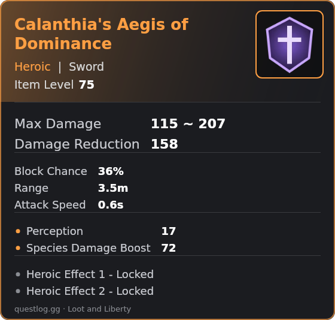
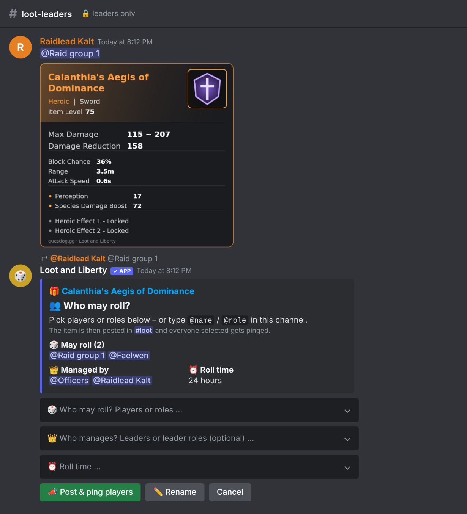
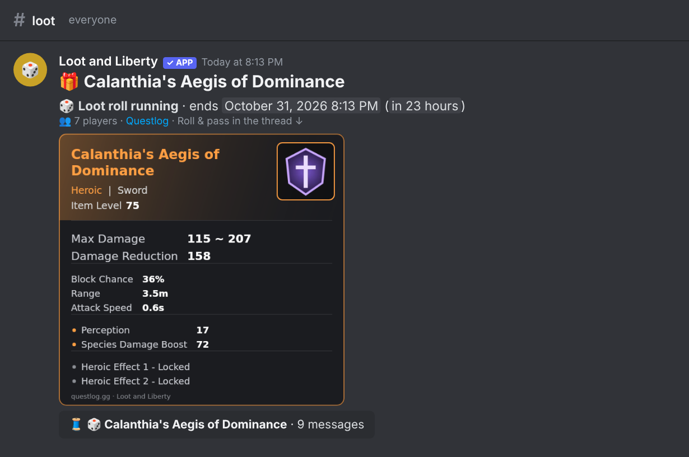
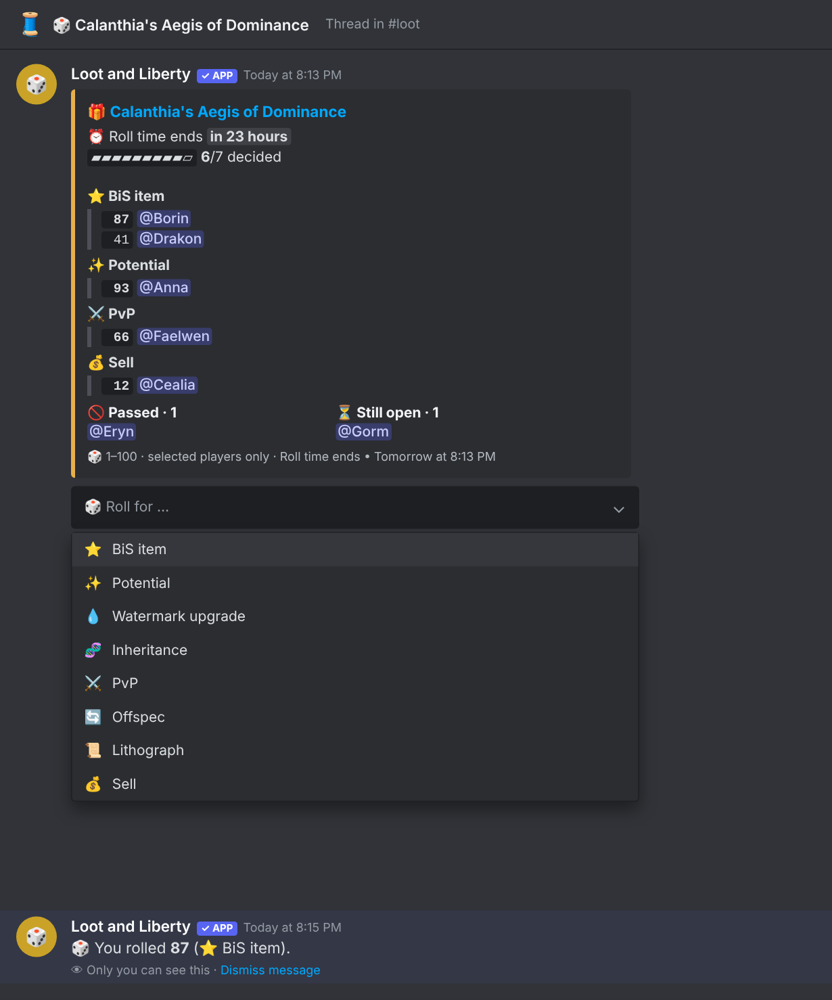
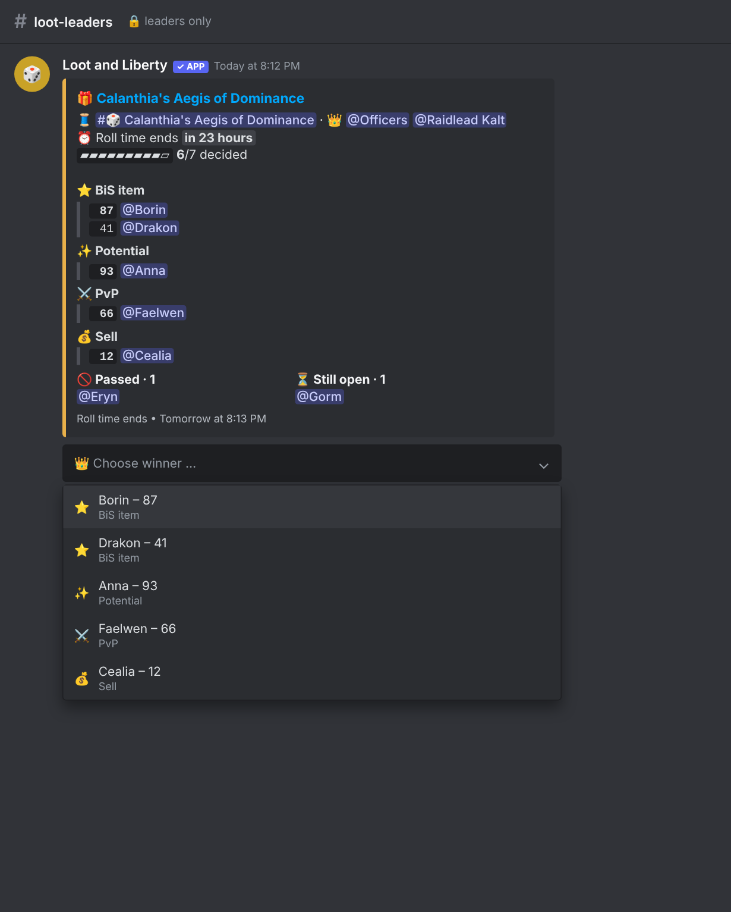
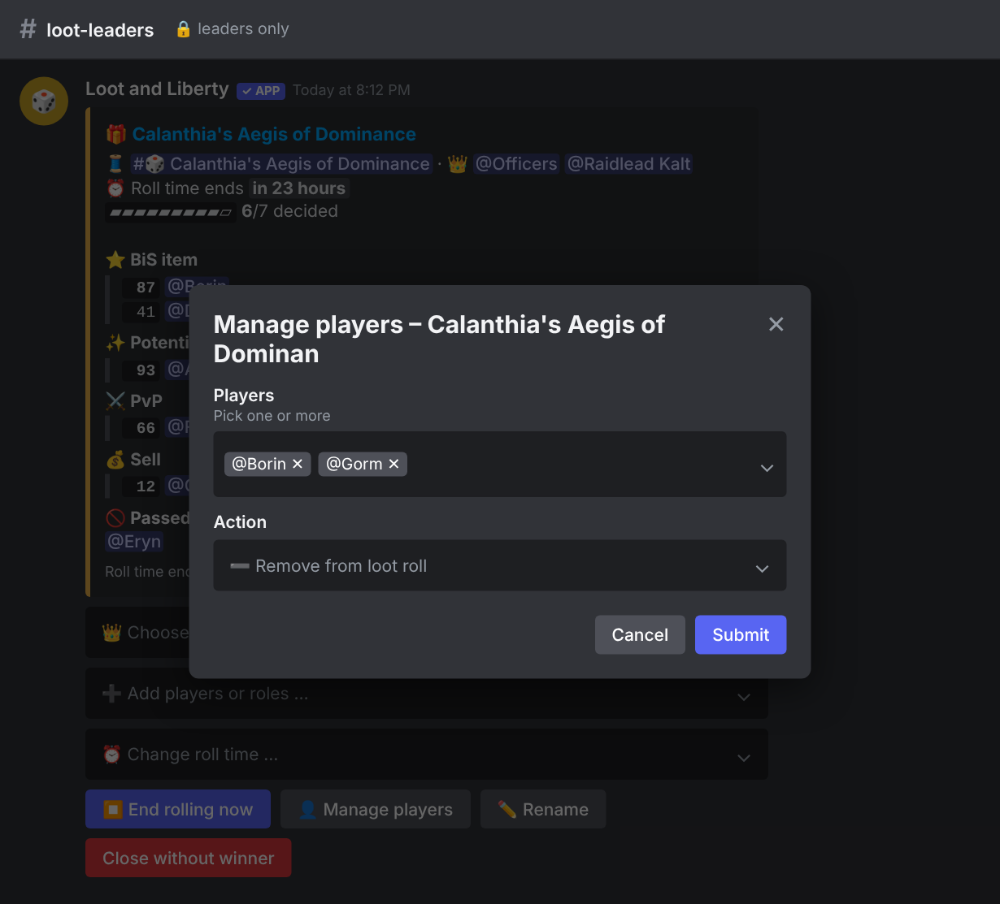
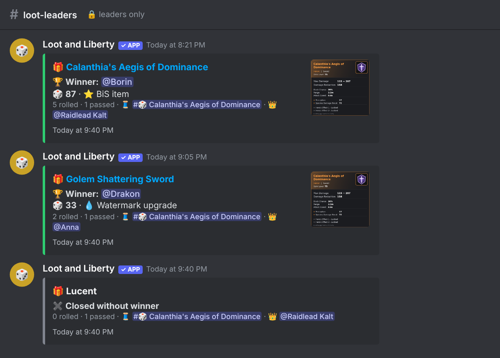
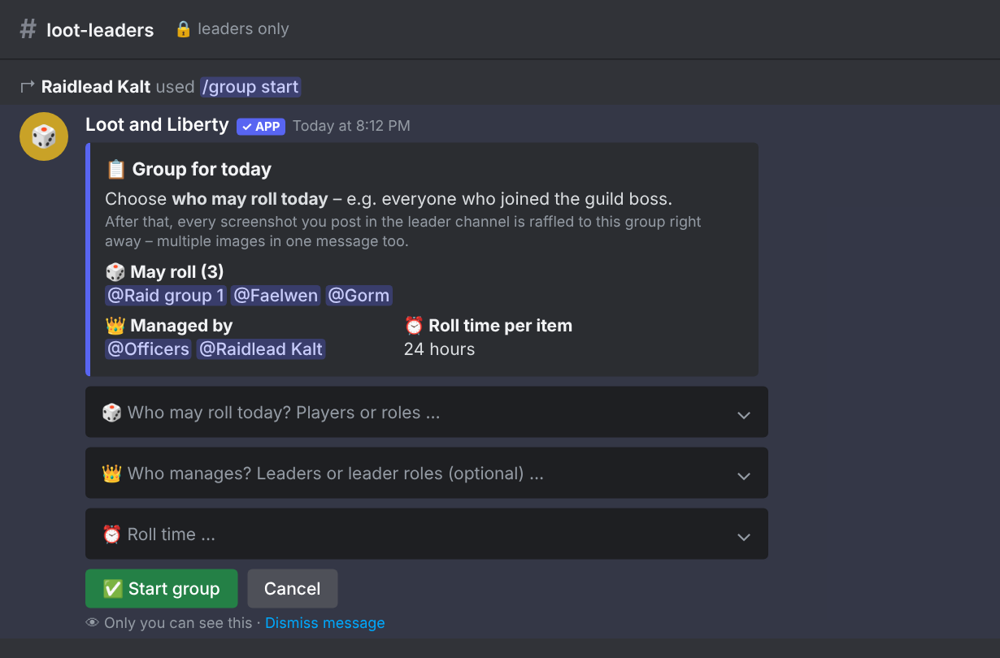

# Loot and Liberty

**A Discord bot for fair, transparent loot distribution in _Throne and Liberty_.**

Leaders post a screenshot or a [Questlog](https://questlog.gg/throne-and-liberty) link, pick who may roll – and the bot handles the rest:
an item post with a thread, pings, rolls 1–100 with a reason (BiS, Potential, PvP …), a live roll list, a roll timer, winner selection and clean-up.

🇩🇪 **[Deutsche Version → README.de.md](README.de.md)** · The bot speaks **English and German** (per server).



## Features

- **Screenshot or Questlog link:** For a Questlog link without a screenshot, the bot draws its own item card with icon, rarity, item level and stats (see above).
- **Who may roll:** pick players and/or roles – or type `@name` / `@role`. Only selected players can roll.
- **Roll reasons in priority order:** ⭐ BiS item · ✨ Potential · 💧 Watermark upgrade · 🧬 Inheritance · ⚔️ PvP · 🔄 Offspec · 📜 Lithograph · 💰 Sell
- **Pass** – even after rolling (the roll then no longer counts).
- **Roll timer** (default 24 h, adjustable per server, per item and while running); the thread is locked and archived afterwards.
- **Leader panel:** choose the winner, add/remove/reset players, change the roll time, rename the item.
- **Managers per loot roll:** individual leaders and/or leader roles.
- **Guild bosses:** with `/group start` set the participants once – every screenshot is then raffled right away, even 5 images in one message.
- **Tidy channels:** after the roll, big posts shrink to compact result cards.
- **Survives restarts:** loot rolls, timers, leaders and settings are stored in a JSON file.

## How it works

There are two channels: a **leader channel** (only leaders can see it) and a **loot channel** (everyone).

### 1. Leader posts the item

A screenshot or Questlog link in the leader channel. Right below, the window **“Who may roll?”** appears: players/roles, managers and roll time.



### 2. Item + thread in the loot channel

The bot posts the item with its image and opens a thread. Everyone selected gets pinged.



### 3. Players roll or pass

In the thread, each selected player chooses what they roll for (1–100) – or passes. The roll list is grouped by priority.



### 4. Leaders manage the loot roll

The leader panel shows the same list. Here the managers choose the winner, add players, change the roll time …



… and remove or reset players via a pop-up – several at once.



### 5. Result

The winner is announced in the thread. In the leader channel the item post, panel and notices are replaced by a compact result card.



### Several items at once (guild boss)

`/group start` – choose who was there today. After that, every screenshot of that leader is raffled to this group immediately (also several images in one message). Valid until `/group end`, at most 12 hours.



## Commands

Discord shows the commands in each user's Discord language (e.g. `/setup` ↔ `/einrichten`).

| Command | Who | What |
| --- | --- | --- |
| `/setup leaderchannel: lootchannel: rolltime: language:` | Bot admins | Channels, default roll time (hours) and language (`de`/`en`). Without options: show current settings |
| `/leader add who:` · `/leader remove who:` | Bot admins | Make a player or role a loot leader / revoke it |
| `/leader list` | Everyone | Show all loot leaders |
| `/group start` · `/group end` · `/group status` | Leaders | Participants for the day; then every screenshot is raffled immediately |
| `/loot open` | Leaders | Running loot rolls with links to thread and panel |
| `/help` | Everyone | Short overview |

### Permissions

| Who | May |
| --- | --- |
| **Bot admins** – server owner, administrators, `BOT_ADMIN_IDS` | Set leaders, `/setup`, everything leaders and managers may do |
| **Loot leaders** – set via `/leader add` (players or roles) | Post items, choose who rolls and who manages |
| **Managers of a loot roll** – the poster plus the leaders/roles chosen when posting | Use the panel of that loot roll |
| **Selected players** | Roll or pass |

## Setup

Requirements: **Node.js 22.9+** and a machine that is always on (e.g. a small VPS).

### 1. Create the bot in Discord

1. [Discord Developer Portal](https://discord.com/developers/applications) → **New Application** → name it e.g. *Loot and Liberty*.
2. **Bot** → **Reset Token** → copy the token (keep it secret!).
3. **Bot → Privileged Gateway Intents**: enable **Server Members Intent** and **Message Content Intent**.
4. Invite the bot (replace `YOUR_APP_ID` with the *Application ID* from *General Information*):
   ```
   https://discord.com/oauth2/authorize?client_id=YOUR_APP_ID&scope=bot+applications.commands&permissions=326417640512
   ```
5. Create two channels: a **leader channel** (only leaders + the bot can see it) and a **loot channel**. The bot needs:
   - **Leader channel:** View Channel, Send Messages, Embed Links, Attach Files, Read Message History, Add Reactions, **Manage Messages** (clean-up)
   - **Loot channel:** View Channel, Send Messages, Embed Links, Attach Files, Create Public Threads, Send Messages in Threads, **Manage Threads** (closing threads)

### 2. Run the bot

```bash
git clone https://github.com/B0R0AK/Loot-and-Liberty.git
cd Loot-and-Liberty
npm install --omit=dev
cp .env.example .env      # enter DISCORD_TOKEN
npm start
```

<details>
<summary>Run permanently on a Linux server (systemd)</summary>

```ini
# /etc/systemd/system/loot-and-liberty.service
[Unit]
Description=Loot and Liberty Discord bot
After=network-online.target
Wants=network-online.target

[Service]
User=lootbot
WorkingDirectory=/opt/loot-and-liberty/app
ExecStart=/usr/bin/npm start
Restart=always
RestartSec=5

[Install]
WantedBy=multi-user.target
```

```bash
sudo systemctl daemon-reload && sudo systemctl enable --now loot-and-liberty
sudo journalctl -u loot-and-liberty -f      # logs
# update:
cd /opt/loot-and-liberty/app && sudo -u lootbot git pull && sudo -u lootbot npm install --omit=dev && sudo systemctl restart loot-and-liberty
```
</details>

### 3. Configure in Discord

```
/setup leaderchannel:#loot-leaders lootchannel:#loot language:English
/leader add who:@Officers
```

Then post a screenshot or Questlog link in the leader channel. 🎲

### Configuration (`.env`)

| Variable | Meaning |
| --- | --- |
| `DISCORD_TOKEN` | Bot token (required) |
| `LOOT_LEADER_CHANNEL_ID`, `LOOT_CHANNEL_ID` | Optional defaults for the channels – `/setup` takes precedence |
| `BOT_ADMIN_IDS` | Optional additional bot admins (user IDs, comma-separated) |
| `LOOT_ROLL_HOURS` | Optional default roll time in hours (24) – `/setup rolltime:` takes precedence |
| `LOOT_LANGUAGE` | Optional default language `de`/`en` (`de`) – `/setup language:` takes precedence |
| `BOT_NAME` | Optional, default `Loot and Liberty` |
| `DATA_FILE` | Optional, default `data/sessions.json` (loot rolls, leaders, settings) |

## Development

```bash
npm install
npm test
```

| File | Content |
| --- | --- |
| `src/session.js` | Loot roll logic: roll, pass, reasons, winner, roll time (no Discord dependency) |
| `src/i18n.js` | All texts in German and English |
| `src/item.js` | Detect screenshots/Questlog links, item names via Questlog's data API |
| `src/itemcard.js` | Draw the item card (PNG) with stats from Questlog data |
| `src/render.js` | Embeds, menus, buttons, pop-ups |
| `src/bot.js` | Discord flow: leader channel, item post + thread, roll time, panel, groups, commands |
| `src/commands.js` | Slash commands (English names with German translations) |
| `src/store.js` | Persistence of loot rolls, groups, leaders and settings (JSON) |
| `src/index.js` | Startup, intents, configuration |

Item data and icons come from [questlog.gg](https://questlog.gg/throne-and-liberty). This project is not affiliated with Questlog, NCSOFT or Amazon Games.

## License

[MIT](LICENSE)
